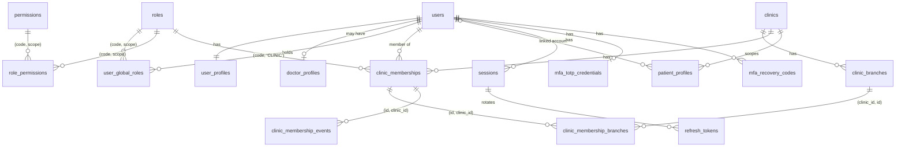

# Identity schema

> **Purpose:** table-by-table reference for the identity, access and audit schema.
>
> Task 02 migrations `20261111140001` – `20261111140020` (`apps/backend/migrations`). All tables:
> InnoDB, `utf8mb4_0900_ai_ci`, UTC `DATETIME(3)`, `BIGINT UNSIGNED` ids (returned as strings).

## Entity relationships

`otp_challenges`, `security_events` and `audit_events` have no foreign keys on purpose (challenges
precede accounts; logs must outlive the rows they describe).

## Tables

| Table                        | Purpose                                                                                      | Key constraints                                                                                                                                                         |
| ---------------------------- | -------------------------------------------------------------------------------------------- | ----------------------------------------------------------------------------------------------------------------------------------------------------------------------- |
| `users`                      | Global account; login = verified phone                                                       | `UNIQUE phone_e164` (E.164 CHECK), `UNIQUE email`, status CHECK (`PENDING_VERIFICATION`, `ACTIVE`, `SUSPENDED`, `INACTIVE`)                                             |
| `user_profiles`              | Display name, locale                                                                         | PK = FK `user_id`                                                                                                                                                       |
| `doctor_profiles`            | Professional identity, clinic-independent                                                    | `UNIQUE user_id`                                                                                                                                                        |
| `clinics`                    | **Minimal tenant anchor** (id, name); extended by the clinic task                            | —                                                                                                                                                                       |
| `clinic_branches`            | Minimal branch anchor                                                                        | `UNIQUE (clinic_id, id)` for composite FKs                                                                                                                              |
| `roles`                      | 6 fixed roles, seeded                                                                        | `UNIQUE (code, scope)`, scope ∈ PLATFORM/CLINIC/PATIENT                                                                                                                 |
| `permissions`                | 30 permissions, seeded                                                                       | `UNIQUE (code, scope)`                                                                                                                                                  |
| `role_permissions`           | Runtime role → permission mapping, seeded                                                    | composite FKs to `(code, scope)` + `CHECK role_scope = permission_scope`                                                                                                |
| `user_global_roles`          | SUPER_ADMIN / PATIENT grants                                                                 | `CHECK role_scope IN ('PLATFORM','PATIENT')`; PK `(user_id, role_code)`                                                                                                 |
| `clinic_memberships`         | User × clinic × role; status, branch scope, effective dates, activated/terminated timestamps | `UNIQUE (clinic_id, user_id, role_code)`, `UNIQUE (id, clinic_id)`, `CHECK role_scope = 'CLINIC'`, status/branch-scope CHECKs, `CHECK effective_until > effective_from` |
| `clinic_membership_branches` | Branch assignments                                                                           | FK `(membership_id, clinic_id)` **and** FK `(clinic_id, branch_id)` → a branch of another clinic cannot be assigned                                                     |
| `clinic_membership_events`   | Append-only status history                                                                   | FK `(membership_id, clinic_id)`                                                                                                                                         |
| `patient_profiles`           | Patient identity **per clinic**                                                              | `UNIQUE (clinic_id, user_id)`, `UNIQUE (clinic_id, id)`                                                                                                                 |
| `otp_challenges`             | OTP challenges                                                                               | PK random `CHAR(32)`; `code_hash` HMAC; status CHECK; `(phone_e164, status)` index                                                                                      |
| `sessions`                   | Device sessions                                                                              | `active_clinic_id` FK (SET NULL); app type CHECK; `(user_id, revoked_at, expires_at)` index                                                                             |
| `refresh_tokens`             | Rotating refresh tokens (hash only)                                                          | `UNIQUE token_hash`, `replaced_by_id` self-FK, status CHECK                                                                                                             |
| `mfa_totp_credentials`       | Encrypted TOTP secret                                                                        | `UNIQUE user_id`; `last_used_step`                                                                                                                                      |
| `mfa_recovery_codes`         | HMAC of single-use codes                                                                     | `UNIQUE (user_id, code_hash)`                                                                                                                                           |
| `security_events`            | Auth/session security log                                                                    | indexes `(user_id, id)`, `(event_type, created_at)`, `(subject_hash, created_at)`                                                                                       |
| `audit_events`               | Privileged changes (who/what/where)                                                          | indexes by target, actor, clinic, action                                                                                                                                |

## Design notes

- **Status columns use `VARCHAR` + `CHECK`** rather than `ENUM`, for readable values and simple
  evolution via migration.
- **No soft deletion.** Memberships are terminated, not deleted (history in
  `clinic_membership_events`). Sessions and tokens are revoked, not deleted. Logs are append-only.
  Purging old OTP challenges, expired sessions and tokens is a future scheduled job (limitation).
- **Composite FKs carry `clinic_id`** wherever a row relates two clinic-scoped records, so
  cross-clinic links are rejected by MySQL itself (tested).
- The seeded catalog rows must equal `catalog.ts`; an integration test compares them.
- Sequential numeric ids are exposed in the API. Every access is authorized, and cross-tenant ids
  return 404 (see DECISIONS ADR-019).
